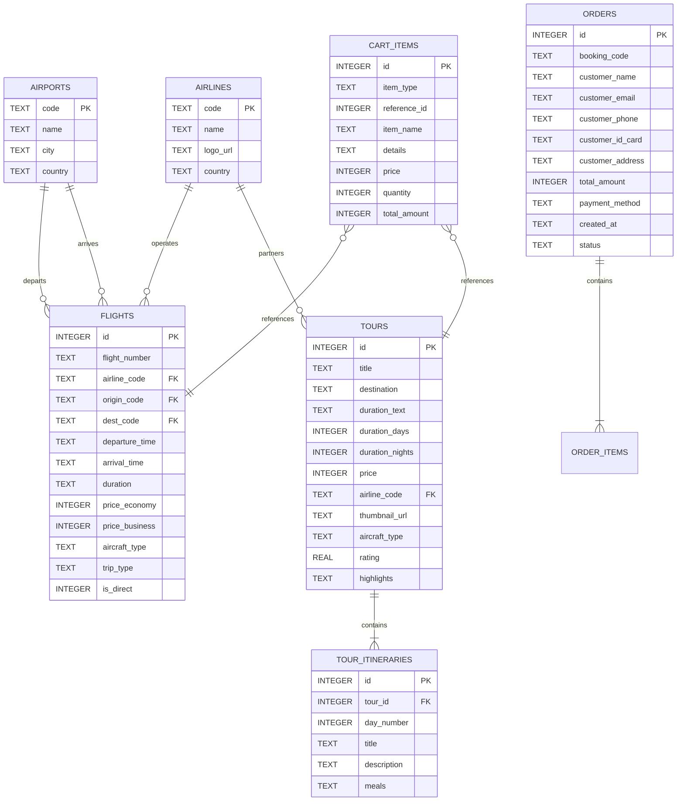

# THIẾT KẾ CƠ SỞ DỮ LIỆU SQLITE (DATABASE_SCHEMA.MD)

Tài liệu thiết kế cấu trúc CSDL SQLite, câu lệnh tạo bảng (DDL), dữ liệu mẫu (Seed Data) và giải pháp chạy SQLite trực tiếp trên trình duyệt (Client-side WebAssembly) không cần backend server.

---

## 1. GIẢI PHÁP SQLITE TRÊN FRONTEND (SQL.JS WASM)

Vì dự án không có backend, chúng ta tích hợp thư viện **`sql.js`** (bản port WebAssembly chính thức của SQLite):
- Thư viện: `https://cdnjs.cloudflare.com/ajax/libs/sql.js/1.8.0/sql-wasm.js`
- Tệp binary WASM: `https://cdnjs.cloudflare.com/ajax/libs/sql.js/1.8.0/sql-wasm.wasm`
- **Cơ chế lưu trữ bền vững (Persistence)**:
  - Khi tải trang: Kiểm tra `localStorage.getItem('vietjet_sqlite_db')`. Nếu đã có, nạp mảng `Uint8Array` vào SQL.js `new SQL.Database(binaryData)`.
  - Nếu chưa có: Khởi tạo CSDL mới, chạy lệnh SQL DDL tạo bảng và INSERT toàn bộ dữ liệu mẫu (Seed Data), sau đó xuất CSDL `db.export()` và lưu vào `localStorage`.
  - Mọi thao tác Thêm / Sửa / Xóa (đặc biệt là Giỏ Hàng và Đơn Hàng) đều tự động gọi hàm `saveDatabase()` để đồng bộ.

---

## 2. LƯỢC ĐỒ QUAN HỆ BẢNG (DATABASE SCHEMA)



---

## 3. MÃ SQL DDL TẠO BẢNG (TABLE DEFINITIONS)

```sql
-- 1. Bảng Hãng Hàng Không
CREATE TABLE IF NOT EXISTS airlines (
    code TEXT PRIMARY KEY,
    name TEXT NOT NULL,
    logo_url TEXT NOT NULL,
    country TEXT DEFAULT 'Vietnam'
);

-- 2. Bảng Sân Bay
CREATE TABLE IF NOT EXISTS airports (
    code TEXT PRIMARY KEY,
    name TEXT NOT NULL,
    city TEXT NOT NULL,
    country TEXT DEFAULT 'Việt Nam'
);

-- 3. Bảng Chuyến Bay
CREATE TABLE IF NOT EXISTS flights (
    id INTEGER PRIMARY KEY AUTOINCREMENT,
    flight_number TEXT NOT NULL,
    airline_code TEXT NOT NULL,
    origin_code TEXT NOT NULL,
    dest_code TEXT NOT NULL,
    departure_time TEXT NOT NULL,       -- Ví dụ: '06:30'
    arrival_time TEXT NOT NULL,         -- Ví dụ: '08:40'
    duration TEXT NOT NULL,             -- Ví dụ: '2h 10m'
    departure_date TEXT NOT NULL,       -- Ví dụ: '2026-11-15'
    price_economy INTEGER NOT NULL,     -- Giá hạng Phổ Thông (VND)
    price_business INTEGER NOT NULL,    -- Giá hạng Thương Gia (VND)
    aircraft_type TEXT NOT NULL,        -- Airbus A321neo / Boeing 787
    trip_type TEXT DEFAULT 'one_way',   -- one_way / round_trip
    is_direct INTEGER DEFAULT 1,        -- 1: Bay thẳng, 0: Quá cảnh
    amenities TEXT,                     -- JSON chuỗi dịch vụ bao gồm
    FOREIGN KEY (airline_code) REFERENCES airlines(code),
    FOREIGN KEY (origin_code) REFERENCES airports(code),
    FOREIGN KEY (dest_code) REFERENCES airports(code)
);

-- 4. Bảng Tour Du Lịch
CREATE TABLE IF NOT EXISTS tours (
    id INTEGER PRIMARY KEY AUTOINCREMENT,
    title TEXT NOT NULL,
    destination TEXT NOT NULL,
    duration_text TEXT NOT NULL,        -- Ví dụ: '3 Ngày 2 Đêm'
    duration_days INTEGER NOT NULL,
    duration_nights INTEGER NOT NULL,
    price INTEGER NOT NULL,             -- Giá tour trọn gói (VND)
    airline_code TEXT NOT NULL,
    thumbnail_url TEXT NOT NULL,        -- Kích thước 600x400
    aircraft_type TEXT NOT NULL,
    departure_time_slot TEXT NOT NULL,  -- 'morning', 'afternoon', 'evening'
    rating REAL DEFAULT 5.0,
    reviews_count INTEGER DEFAULT 120,
    highlights TEXT,
    included_services TEXT,
    FOREIGN KEY (airline_code) REFERENCES airlines(code)
);

-- 5. Bảng Lịch Trình Chi Tiết Tour
CREATE TABLE IF NOT EXISTS tour_itineraries (
    id INTEGER PRIMARY KEY AUTOINCREMENT,
    tour_id INTEGER NOT NULL,
    day_number INTEGER NOT NULL,
    title TEXT NOT NULL,
    description TEXT NOT NULL,
    meals TEXT,
    FOREIGN KEY (tour_id) REFERENCES tours(id) ON DELETE CASCADE
);

-- 6. Bảng Giỏ Hàng (Lưu trực tiếp trong SQLite client)
CREATE TABLE IF NOT EXISTS cart_items (
    id INTEGER PRIMARY KEY AUTOINCREMENT,
    item_type TEXT NOT NULL,            -- 'flight' hoặc 'tour'
    reference_id INTEGER NOT NULL,
    item_name TEXT NOT NULL,
    details TEXT,                       -- Chi tiết hạng vé, ngày khởi hành
    price INTEGER NOT NULL,
    quantity INTEGER DEFAULT 1,
    total_amount INTEGER NOT NULL,
    created_at DATETIME DEFAULT CURRENT_TIMESTAMP
);

-- 7. Bảng Đơn Hàng Đã Đặt
CREATE TABLE IF NOT EXISTS orders (
    id INTEGER PRIMARY KEY AUTOINCREMENT,
    booking_code TEXT NOT NULL UNIQUE,  -- Ví dụ: 'VJ-892410'
    customer_name TEXT NOT NULL,
    customer_email TEXT NOT NULL,
    customer_phone TEXT NOT NULL,
    customer_id_card TEXT NOT NULL,
    customer_address TEXT,
    total_amount INTEGER NOT NULL,
    payment_method TEXT NOT NULL,
    order_details TEXT,                 -- JSON snapshot các mục đã đặt
    created_at DATETIME DEFAULT CURRENT_TIMESTAMP,
    status TEXT DEFAULT 'completed'     -- 'pending', 'completed'
);
```

---

## 4. DỮ LIỆU MẪU ĐẦY ĐỦ (SEED DATA)

```sql
-- Dữ liệu Sân Bay
INSERT OR REPLACE INTO airports (code, name, city) VALUES
('SGN', 'Sân bay Quốc tế Tân Sơn Nhất', 'TP. Hồ Chí Minh'),
('HAN', 'Sân bay Quốc tế Nội Bài', 'Hà Nội'),
('DAD', 'Sân bay Quốc tế Đà Nẵng', 'Đà Nẵng'),
('CXR', 'Sân bay Quốc tế Cam Ranh', 'Nha Trang'),
('PQC', 'Sân bay Quốc tế Phú Quốc', 'Phú Quốc'),
('BKK', 'Sân bay Suvarnabhumi', 'Bangkok'),
('ICN', 'Sân bay Quốc tế Incheon', 'Seoul'),
('NRT', 'Sân bay Quốc tế Narita', 'Tokyo'),
('SIN', 'Sân bay Changi Singapore', 'Singapore');

-- Dữ liệu Hãng Hàng Không
INSERT OR REPLACE INTO airlines (code, name, logo_url, country) VALUES
('VJ', 'VietJet Air', 'images/1794032794428_7798941419347914444_g4111106518249197050_b20246c106060b907dfe9e17d280275d.jpg', 'Việt Nam'),
('VN', 'Vietnam Airlines', 'https://upload.wikimedia.org/wikipedia/commons/thumb/e/e0/Vietnam_Airlines_logo.svg/320px-Vietnam_Airlines_logo.svg.png', 'Việt Nam'),
('QH', 'Bamboo Airways', 'https://upload.wikimedia.org/wikipedia/commons/thumb/6/69/Bamboo_Airways_logo.svg/320px-Bamboo_Airways_logo.svg.png', 'Việt Nam'),
('SQ', 'Singapore Airlines', 'https://upload.wikimedia.org/wikipedia/en/thumb/6/6b/Singapore_Airlines_Logo_2.svg/320px-Singapore_Airlines_Logo_2.svg.png', 'Singapore'),
('AK', 'AirAsia', 'https://upload.wikimedia.org/wikipedia/commons/thumb/f/f5/AirAsia_New_Logo.svg/320px-AirAsia_New_Logo.svg.png', 'Malaysia'),
('QR', 'Qatar Airways', 'https://upload.wikimedia.org/wikipedia/en/thumb/9/9b/Qatar_Airways_Logo.svg/320px-Qatar_Airways_Logo.svg.png', 'Qatar');

-- Dữ liệu 8 Tour Du Lịch Nổi Bật (Thumbnail chuẩn 600x400)
INSERT OR REPLACE INTO tours (id, title, destination, duration_text, duration_days, duration_nights, price, airline_code, thumbnail_url, aircraft_type, departure_time_slot, rating, reviews_count, highlights) VALUES
(1, 'Tour Phú Quốc 3N2Đ - Thiên Đường Đảo Ngọc & Cáp Treo Hòn Thơm', 'Phú Quốc', '3 Ngày 2 Đêm', 3, 2, 3890000, 'VJ', 'https://images.unsplash.com/photo-1540555700478-4be289fbecef?w=600&h=400&fit=crop', 'Airbus A321neo', 'morning', 4.9, 215, 'Trải nghiệm cáp treo vượt biển dài nhất thế giới, Grand World, lặn ngắm san hô'),
(2, 'Tour Đà Nẵng - Hội An - Bà Nà Hills 4N3Đ - Cầu Vàng Huyền Thoại', 'Đà Nẵng', '4 Ngày 3 Đêm', 4, 3, 4590000, 'VJ', 'https://images.unsplash.com/photo-1559592413-7cec4d0cae2b?w=600&h=400&fit=crop', 'Airbus A321', 'morning', 5.0, 340, 'Check-in Cầu Vàng, phố cổ Hội An rực rỡ đèn lồng, du thuyền sông Hàn'),
(3, 'Tour Hà Nội - Sapa - Fansipan 4N3Đ - Nóc Nhà Đông Dương', 'Sapa - Hà Nội', '4 Ngày 3 Đêm', 4, 3, 4990000, 'VN', 'https://images.unsplash.com/photo-1528127269322-539801943592?w=600&h=400&fit=crop', 'Boeing 787-9', 'morning', 4.8, 180, 'Chinh phục đỉnh Fansipan 3.143m, bản Cát Cát, thung lũng Mường Hoa'),
(4, 'Tour Nha Trang 3N2Đ - Vịnh San Hô & Thiên Đường VinWonders', 'Nha Trang', '3 Ngày 2 Đêm', 3, 2, 3490000, 'VJ', 'https://images.unsplash.com/photo-1507525428034-b723cf961d3e?w=600&h=400&fit=crop', 'Airbus A320', 'afternoon', 4.9, 195, 'Khám phá 4 đảo vịnh Nha Trang, tắm bùn khoáng nóng, vui chơi VinWonders'),
(5, 'Tour Bangkok - Pattaya 5N4Đ - Xứ Sở Chùa Vàng Thái Lan', 'Bangkok, Thái Lan', '5 Ngày 4 Đêm', 5, 4, 6290000, 'VJ', 'https://images.unsplash.com/photo-1508009603885-50cf7c579365?w=600&h=400&fit=crop', 'Airbus A321neo', 'morning', 4.8, 412, 'Chùa Phật Vàng, chợ nổi Bốn Miền, dạo thuyền sông Chao Phraya, buffet 86 tầng Baiyoke'),
(6, 'Tour Seoul - Nami - Công Viên Everland Hàn Quốc 5N4Đ', 'Seoul, Hàn Quốc', '5 Ngày 4 Đêm', 5, 4, 14990000, 'VJ', 'https://images.unsplash.com/photo-1538485399081-7191377e8241?w=600&h=400&fit=crop', 'Airbus A330-300', 'evening', 5.0, 276, 'Đảo Nami thơ mộng, cung điện Gyeongbokgung, làng Hanok Bukchon, tháp N Seoul'),
(7, 'Tour Tokyo - Núi Phú Sĩ - Làng Cổ Oshino Hakkai Nhật Bản 6N5Đ', 'Tokyo, Nhật Bản', '6 Ngày 5 Đêm', 6, 5, 23990000, 'SQ', 'https://images.unsplash.com/photo-1503899036084-c55cdd92da26?w=600&h=400&fit=crop', 'Boeing 787 Dreamliner', 'morning', 4.9, 158, 'Ngắm núi Phú Sĩ kỳ vĩ, chùa cổ Asakusa Sensoji, phố Shibuya tấp nập, tắm khoáng Onsen'),
(8, 'Tour Liên Tuyến Singapore - Malaysia 5N4Đ - Thành Phố Hiện Đại', 'Singapore & Malaysia', '5 Ngày 4 Đêm', 5, 4, 9890000, 'VJ', 'https://images.unsplash.com/photo-1525625293386-3f8f99389edd?w=600&h=400&fit=crop', 'Airbus A321', 'afternoon', 4.9, 320, 'Gardens by the Bay, tượng Merlion, tháp đôi Petronas, động Batu, cao nguyên Genting');

-- Dữ liệu Chuyến Bay Thực Tế
INSERT OR REPLACE INTO flights (id, flight_number, airline_code, origin_code, dest_code, departure_time, arrival_time, duration, departure_date, price_economy, price_business, aircraft_type, trip_type, is_direct) VALUES
(1, 'VJ-120', 'VJ', 'SGN', 'HAN', '06:15', '08:25', '2h 10m', '2026-11-15', 799000, 2450000, 'Airbus A321neo', 'round_trip', 1),
(2, 'VJ-134', 'VJ', 'SGN', 'HAN', '09:30', '11:40', '2h 10m', '2026-11-15', 890000, 2690000, 'Airbus A321neo', 'one_way', 1),
(3, 'VJ-152', 'VJ', 'SGN', 'HAN', '14:20', '16:30', '2h 10m', '2026-11-15', 850000, 2590000, 'Airbus A330-300', 'one_way', 1),
(4, 'VJ-178', 'VJ', 'SGN', 'HAN', '19:45', '21:55', '2h 10m', '2026-11-15', 720000, 2390000, 'Airbus A321', 'one_way', 1),
(5, 'VN-210', 'VN', 'SGN', 'HAN', '07:00', '09:10', '2h 10m', '2026-11-15', 1250000, 3850000, 'Boeing 787-9', 'round_trip', 1),
(6, 'VN-254', 'VN', 'SGN', 'HAN', '11:15', '13:25', '2h 10m', '2026-11-15', 1350000, 4100000, 'Airbus A350-900', 'one_way', 1),
(7, 'QH-202', 'QH', 'SGN', 'HAN', '08:30', '10:40', '2h 10m', '2026-11-15', 990000, 2890000, 'Boeing 787-9', 'one_way', 1),
(8, 'VJ-622', 'VJ', 'SGN', 'DAD', '07:30', '08:50', '1h 20m', '2026-11-15', 599000, 1890000, 'Airbus A320', 'one_way', 1),
(9, 'VN-118', 'VN', 'SGN', 'DAD', '10:00', '11:20', '1h 20m', '2026-11-15', 950000, 2400000, 'Airbus A321', 'round_trip', 1),
(10, 'VJ-320', 'VJ', 'SGN', 'PQC', '08:00', '09:00', '1h 00m', '2026-11-15', 490000, 1690000, 'Airbus A321neo', 'one_way', 1),
(11, 'VJ-801', 'VJ', 'SGN', 'BKK', '09:15', '10:45', '1h 30m', '2026-11-15', 1190000, 3290000, 'Airbus A321', 'round_trip', 1),
(12, 'SQ-178', 'SQ', 'SGN', 'SIN', '12:15', '15:20', '2h 05m', '2026-11-15', 2450000, 6800000, 'Boeing 787-10', 'round_trip', 1);

-- Dữ liệu Lịch Trình Chi Tiết cho Tour Phú Quốc (Mẫu)
INSERT OR REPLACE INTO tour_itineraries (tour_id, day_number, title, description, meals) VALUES
(1, 1, 'Hạ Cánh Phú Quốc - Khám Phá Grand World', 'Xe và HDV đón quý khách tại Sân bay Phú Quốc. Nhận phòng khách sạn 4 sao, ăn trưa đặc sản gỏi cá trích. Chiều tham quan Thành phố không ngủ Grand World, xem show Sắc màu Venice.', 'Trưa, Tối'),
(1, 2, 'Trải Nghiệm Cáp Treo Hòn Thơm - Câu Cá Lặn Ngắm San Hô', 'Chinh phục Cáp treo Hòn Thơm vượt biển 7.899m. Trải nghiệm công viên nước Aquatopia. Đi cano ra 4 đảo ngắm san hô tự nhiên tuyệt đẹp.', 'Sáng, Trưa, Tối'),
(1, 3, 'Mua Sắm Đặc Sản - Tạm Biệt Phú Quốc', 'Tham quan trang trại ngọc trai Phú Quốc, nhà thùng nước mắm truyền thống, vườn tiêu suối Đá. Xe đưa đoàn ra sân bay làm thủ tục chuyến bay về.', 'Sáng, Trưa');
```

---

## 5. THỰC HIỆN TÍCH HỢP JAVASCRIPT (`js/database.js`)

File này tải `sql.js`, nạp dữ liệu SQLite và cung cấp các hàm API tiện ích cho ứng dụng:

```javascript
/**
 * js/database.js - SQLite Client Wrapper
 */
class VietjetDB {
    constructor() {
        this.db = null;
        this.SQL = null;
        this.readyPromise = this.init();
    }

    async init() {
        // Tải WebAssembly SQLite
        this.SQL = await window.initSqlJs({
            locateFile: file => `https://cdnjs.cloudflare.com/ajax/libs/sql.js/1.8.0/${file}`
        });

        // Kiểm tra dữ liệu đã lưu trong localStorage
        const savedData = localStorage.getItem('vietjet_sqlite_db');
        if (savedData) {
            const uInt8Array = new Uint8Array(JSON.parse(savedData));
            this.db = new this.SQL.Database(uInt8Array);
            console.log('✅ SQLite loaded from localStorage');
        } else {
            this.db = new this.SQL.Database();
            console.log('⚡ Initializing new SQLite Database with Seed Data...');
            await this.seedInitialData();
            this.persist();
        }
    }

    persist() {
        if (!this.db) return;
        const binaryArray = this.db.export();
        localStorage.setItem('vietjet_sqlite_db', JSON.stringify(Array.from(binaryArray)));
    }

    async seedInitialData() {
        // Chạy các câu lệnh DDL và Seed Data đã định nghĩa
        this.db.run(SQL_DDL_AND_SEED_STATEMENTS);
    }

    // Helper thực hiện truy vấn SELECT trả về mảng Objects
    query(sql, params = []) {
        const stmt = this.db.prepare(sql);
        stmt.bind(params);
        const results = [];
        while (stmt.step()) {
            results.push(stmt.getAsObject());
        }
        stmt.free();
        return results;
    }

    // Helper thực hiện INSERT / UPDATE / DELETE
    execute(sql, params = []) {
        this.db.run(sql, params);
        this.persist();
    }
}

// Khởi tạo instance toàn cục
window.vietjetDB = new VietjetDB();
```
